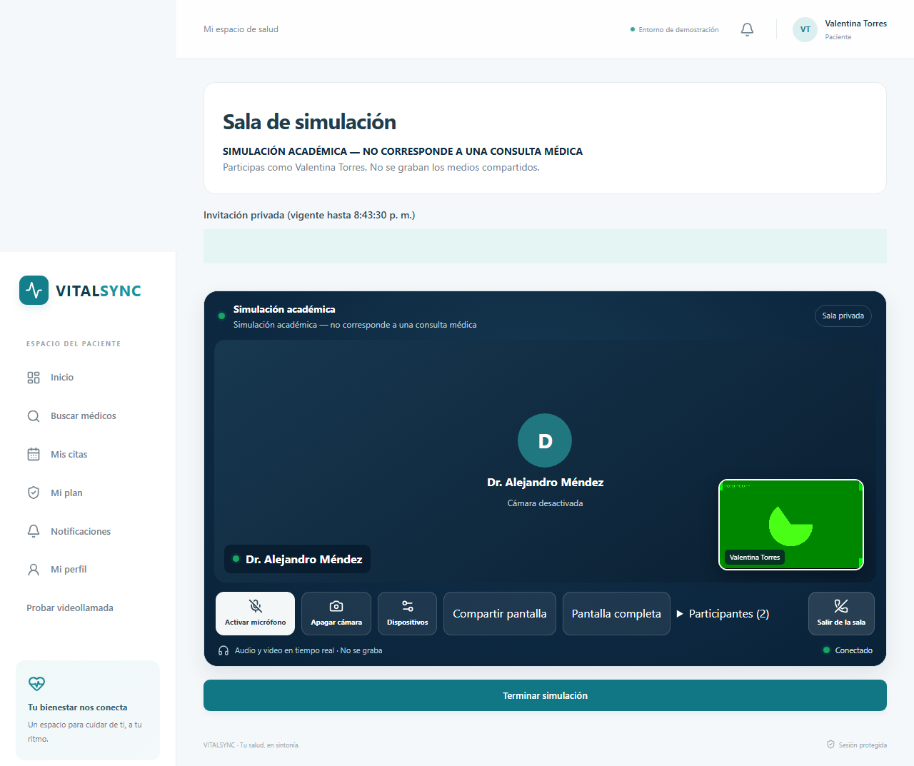

# VITALSYNC — Réplica académica y propuesta de mejoras

**Proyecto universitario de análisis y desarrollo de sistemas · Ingeniería de Sistemas · Fundación Universitaria CEIPA · 2026**

**Versión académica:** [v1.1.0](https://github.com/MiguelArbelaez0/VITALSYNC-FULLSTACK/releases/tag/v1.1.0) · **Rama de desarrollo:** `develop` · **Estado:** prototipo funcional de demostración local

> [!IMPORTANT]
> **Este repositorio NO es el producto oficial de VitalSync.** VitalSync es una empresa/plataforma preexistente que se tomó como referente en una actividad asignada por la universidad. Nuestro trabajo consistió en **analizar el caso, desarrollar una réplica funcional académica, proponer e implementar mejoras y preparar su sustentación al finalizar el semestre**. Es un ejercicio independiente, sin afiliación, representación ni respaldo de la empresa original.

## ¿En qué consistió el proyecto?

La actividad académica no consistía en fundar una nueva empresa de telemedicina ni en ofrecer atención médica real. El reto era estudiar una plataforma existente y llevar el análisis de sistemas a un prototipo verificable.

El trabajo realizado abarca:

1. **Análisis:** identificación de actores, requisitos, casos de uso, reglas de negocio y estados de las citas.
2. **Diseño:** definición de los procesos del paciente, médico y administrador, así como de sus permisos e interacciones.
3. **Réplica funcional:** implementación independiente de una aplicación fullstack que reproduce los flujos principales del caso de estudio.
4. **Mejoras propuestas:** ampliación del prototipo con gestión por roles, aprobación de médicos, videollamadas reales mediante LiveKit y espacios de simulación independientes de las citas.
5. **Verificación y sustentación:** pruebas, evidencia visual, documentación y recorridos demostrables para la evaluación de fin de semestre.

Las funcionalidades implementadas son parte de **nuestra propuesta académica**; no constituyen una descripción certificada del software de la empresa tomada como referencia.

## Funcionalidades del prototipo

| Módulo | Funcionalidades implementadas |
| --- | --- |
| **Paciente** | Registro con correo personal, inicio de sesión, Google (si está configurado), perfil, planes, reservas, pagos simulados, citas e historial |
| **Médico** | Solicitud de registro, correo institucional de demostración generado automáticamente, aprobación administrativa, cuenta individual, agenda, pacientes asignados e historias clínicas ficticias autorizadas |
| **Administrador** | Gestión de pacientes, médicos, solicitudes profesionales, disponibilidad, planes, citas, pagos/devoluciones simuladas y auditoría |
| **Videoconsulta** | Sala privada con LiveKit/WebRTC, cámara y micrófono opcionales, cambio de dispositivos, pantalla compartida, reconexión y finalización persistente por el médico |
| **Sala de simulación** | Prueba individual o con invitación privada, sin crear una cita, contratar un plan ni efectuar pagos |
| **Seguridad y datos** | Roles y permisos comprobados en FastAPI, sesiones, transacciones, migraciones Alembic y persistencia PostgreSQL |

### Acceso único para los tres roles

La aplicación tiene una pantalla compartida de autenticación. Después de verificar la cuenta, el backend determina su rol y la aplicación dirige al usuario a su portal:

- Paciente → `/portal`.
- Médico → `/doctor`.
- Administrador → `/admin`.

El registro público permite crear pacientes y **solicitar** un perfil médico. Una solicitud médica no concede permisos clínicos: necesita aprobación administrativa. El correo médico de demostración sigue la convención `nombre.apellido@doctor.vitalsync.demo`; es un identificador local, **no una dirección de correo real**. Solo los pacientes pueden utilizar el acceso con Google; los médicos y administradores utilizan sus credenciales asignadas.

### Videollamadas y simulación

En `v1.1.0`, las videoconsultas pueden conectar audio y video reales por WebRTC cuando LiveKit está configurado. **Entrar sin cámara o con el micrófono apagado es válido**. Salir de una llamada no equivale a finalizar la consulta: la finalización formal corresponde al médico autorizado y se refleja en los historiales.

La **Sala de simulación** permite practicar con dispositivos y pantalla compartida, a solas o con un segundo usuario autorizado, sin alterar el calendario ni los pagos. Las salas de prueba no representan actos médicos ni crean historias clínicas.



## Tecnologías y arquitectura

| Capa | Tecnologías |
| --- | --- |
| Interfaz | React 19, TypeScript, Vite, React Router, Tailwind CSS, TanStack Query |
| API y negocio | Python 3.13, FastAPI, Pydantic, SQLAlchemy |
| Datos | PostgreSQL 17, Alembic, restricciones e integridad transaccional |
| Identidad | Sesiones con cookies HttpOnly, Argon2id, Google Identity Services solo para pacientes |
| Videollamadas | LiveKit autohospedado y WebRTC |
| Infraestructura | Docker Compose, nginx y scripts PowerShell |
| Calidad | pytest, Vitest, Playwright y GitHub Actions |

```text
Paciente / Médico / Administrador (React)
                   |
             API REST /api
                   |
           FastAPI + permisos
             /           \
     PostgreSQL        LiveKit
   datos e historial   audio y video
```

El backend verifica las autorizaciones y las reglas de negocio; React no decide quién puede consultar historias clínicas, emitir tokens de sala o ejecutar acciones administrativas. Los datos clínicos de demostración son sintéticos.

## Ejecutar VITALSYNC localmente

### Requisitos

- Windows 11 con PowerShell (entorno de desarrollo documentado).
- Docker Desktop en modo contenedores Linux y Docker Compose v2.
- Git.
- Internet para descargar las dependencias y, opcionalmente, utilizar el inicio de sesión con Google.

Node.js y Python locales son opcionales si se ejecuta la aplicación únicamente en Docker.

### Preparar el entorno

```powershell
git clone https://github.com/MiguelArbelaez0/VITALSYNC-FULLSTACK.git
cd VITALSYNC-FULLSTACK
Copy-Item .env.example .env
```

Configura las variables locales antes de arrancar. Para las funcionalidades de video y la entrega privada de credenciales médicas, utiliza los scripts del proyecto:

```powershell
.\infrastructure\Configure-LiveKit.ps1
.\infrastructure\Configure-DoctorCredentials.ps1
docker compose -p vitalsync --profile video up -d --build --wait
docker compose -p vitalsync --profile video ps
```

**Precaución sobre PostgreSQL:** este proyecto utiliza un volumen persistente protegido (`vitalsync_vitalsync_data`). En una instalación nueva puede requerirse inicializarlo o restaurarlo mediante el procedimiento de [Docker unificado](docs/DOCKER_UNIFICADO.md) antes del arranque. **No elimines volúmenes ni ejecutes `docker compose down -v` para resolver errores de inicio.** El código clonado no incluye la base de datos privada de otro equipo.

### Direcciones locales

| Servicio | URL |
| --- | --- |
| Inicio y login compartido | http://localhost:5188/login |
| Registro compartido | http://localhost:5188/auth |
| Portal paciente | http://localhost:5188/portal |
| Portal médico | http://localhost:5188/doctor |
| Portal administrador | http://localhost:5188/admin |
| API / Swagger | http://localhost:8088/docs |
| Estado de la API | http://localhost:8088/api/health |

**Credenciales:** el README no distribuye contraseñas. Los perfiles demo utilizan credenciales individuales que se preparan o entregan mediante procedimientos locales privados. Un visitante puede crear un paciente ficticio desde el registro. Para las cuentas médicas es necesaria la aprobación administrativa.

**Google:** para utilizar el botón oficial configura `GOOGLE_CLIENT_ID` y `VITE_GOOGLE_CLIENT_ID` con el Client ID de tu propio proyecto de Google Cloud. Consulta [Google Identity Services](docs/google-auth-v1.1.md).

**Redes externas:** el despliegue local de LiveKit está preparado para `localhost`. La conexión entre redes requiere infraestructura y configuración adicionales, incluidos HTTPS/WSS e ICE/TURN; no debe asumirse disponible por ejecutar Compose.

## Pruebas y evidencia

La validación local documentada de `v1.1.0` informa **200 pruebas backend** y **66 frontend** aprobadas, junto con recorridos E2E de registro, aprobación médica, reservas, LiveKit, reconexión, finalización y sala de simulación. Los E2E audiovisuales de esta revisión utilizan medios sintéticos. El acceso real de Google, la calidad audible y las llamadas entre redes diferentes **requieren verificaciones manuales adicionales**.

```powershell
.\infrastructure\Test-Backend.ps1
npm --prefix frontend ci
npm --prefix frontend test
npm --prefix frontend run build
.\infrastructure\test-livekit.ps1
```

Las pruebas que modifican datos utilizan bases aisladas de PostgreSQL. Consulta los resultados y límites concretos en [docs/VALIDACION.md](docs/VALIDACION.md). Los trabajos de integración continua se pueden consultar en [GitHub Actions](https://github.com/MiguelArbelaez0/VITALSYNC-FULLSTACK/actions).

## Documentación para la sustentación

- [Arquitectura y reglas de negocio](docs/ARQUITECTURA.md)
- [Guía de demostración del paciente](docs/GUIA_DEMOSTRACION_PACIENTE.md)
- [Registro unificado y aprobación médica](docs/auth-registration-v1.1.md)
- [Google para pacientes](docs/google-auth-v1.1.md)
- [Portal médico](docs/doctor-portal.md)
- [Portal administrativo](docs/admin-portal.md)
- [Videollamadas LiveKit y salas de simulación](docs/video-consultations-v1.1.md)
- [Docker, respaldo y recuperación](docs/DOCKER_UNIFICADO.md)
- [Validaciones y evidencia de pruebas](docs/VALIDACION.md)

### Capturas de la implementación académica

| Interfaz | Evidencia |
| --- | --- |
| Paciente | [Dashboard](docs/screenshots/dashboard-desktop.png) |
| Médico | [Portal médico](docs/screenshots/doctor-dashboard-desktop.png) |
| Administrador | [Dashboard administrativo](docs/screenshots/admin-dashboard-desktop.png) |
| Videollamada | [Sala LiveKit](docs/screenshots/livekit-room-desktop.png) |
| Simulación | [Sala de prueba](docs/screenshots/simulation-desktop.png) |
| Pantalla compartida | [Demostración](docs/screenshots/simulation-shared-screen.png) |

## Evolución del trabajo

| Versión | Entrega |
| --- | --- |
| [v1.0.0](https://github.com/MiguelArbelaez0/VITALSYNC-FULLSTACK/releases/tag/v1.0.0) | Réplica académica inicial con los tres portales, gestión de citas, pagos simulados y teleconsulta por estados |
| [v1.1.0](https://github.com/MiguelArbelaez0/VITALSYNC-FULLSTACK/releases/tag/v1.1.0) | Inicio y registro unificados, Google para pacientes, solicitudes médicas, LiveKit y salas de simulación |

La documentación y el repositorio muestran **el desarrollo realizado por el equipo universitario**, no un lanzamiento, actualización o producto de la empresa de referencia.

## Alcance y aviso de uso

Este proyecto se desarrolló **exclusivamente para aprendizaje, evaluación y sustentación universitaria**. La marca y el nombre de la plataforma de referencia pertenecen a sus respectivos titulares; este repositorio no implica afiliación ni autorización de la empresa original.

- **No es un servicio de telemedicina operativo**, ni está diseñado para atender pacientes reales.
- Los pacientes y las historias clínicas de la demostración deben ser **ficticios**.
- Los pagos, copagos y devoluciones son **simulados**; no se transfieren fondos.
- El uso local de LiveKit puede transmitir audio y video en tiempo real, pero **la aplicación no los graba ni genera transcripciones**.
- Las pruebas automatizadas y el funcionamiento local **no equivalen a una certificación de seguridad, cumplimiento legal o aptitud clínica**.
- No se deben introducir documentos, historiales médicos ni credenciales reales en una instalación académica compartida.

**Propósito de la entrega:** demostrar cómo un caso de estudio universitario puede traducirse en análisis, diseño, implementación, validación y mejoras funcionales verificables al cierre del semestre.
