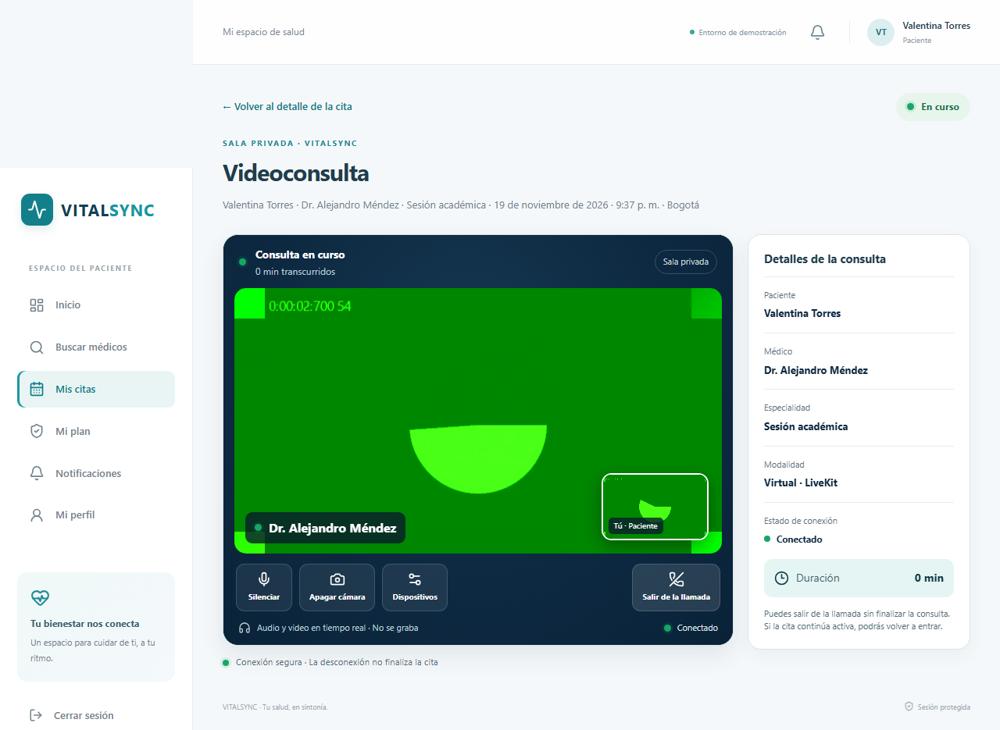
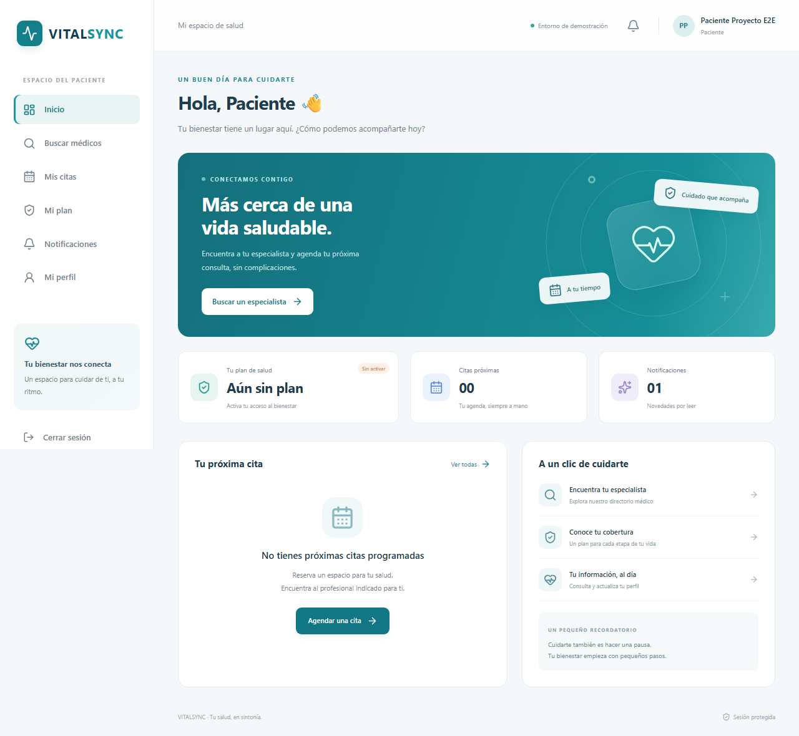
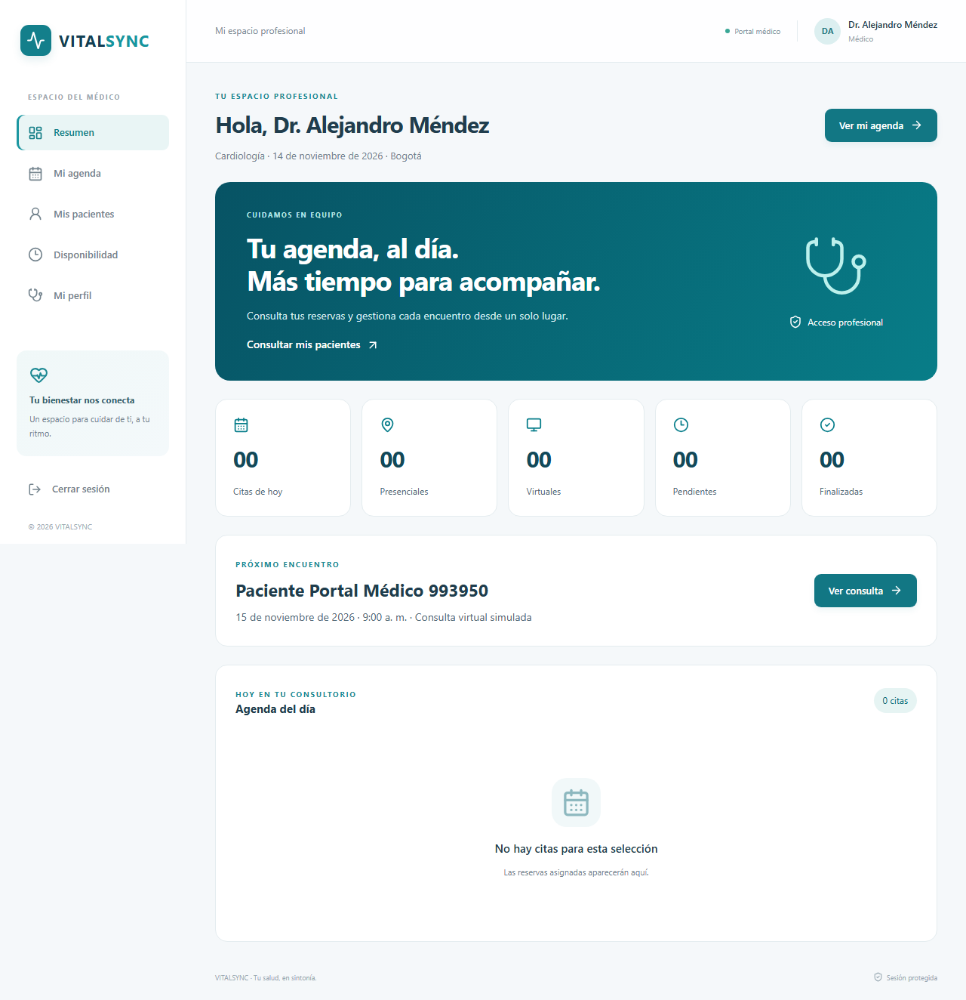
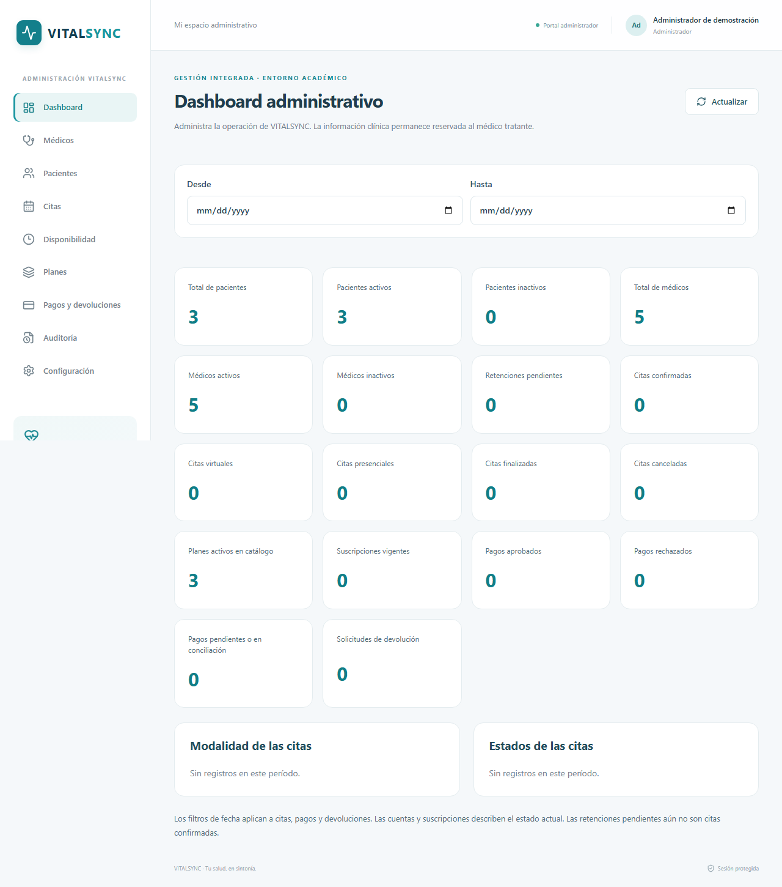
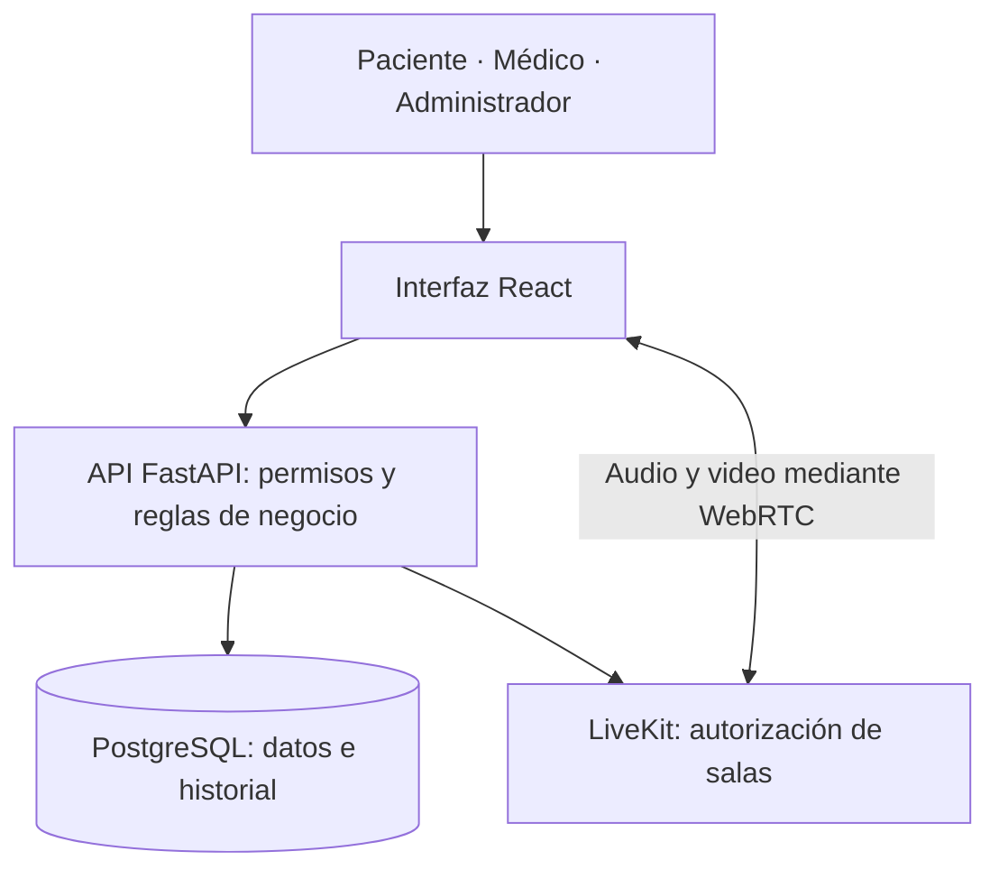

# VITALSYNC

> **Estado:** Completado  
> **Versión:** `v1.1.0 (release)`  
> **Tecnologías:** React · TypeScript · FastAPI · PostgreSQL · Docker · LiveKit

### Plataforma web de gestión de citas y videoconsultas

**Réplica académica de una plataforma existente, con mejoras funcionales desarrolladas para un proyecto universitario.**

**React · TypeScript · FastAPI · PostgreSQL · Docker · LiveKit**

[**Explorar las funcionalidades**](#funcionalidades) · [**Ver las capturas**](#recorrido-visual) · [**Ejecutar el proyecto**](#ejecución-local) · [**Consultar las pruebas**](#pruebas-y-validación) · [**Versión 1.1.0**](https://github.com/MiguelArbelaez0/VITALSYNC-FULLSTACK/releases/tag/v1.1.0)



> **Contexto académico:** VITALSYNC se desarrolló en el marco de una actividad de **Ingeniería de Sistemas de la Fundación Universitaria CEIPA (2026)**. La universidad propuso analizar una plataforma llamada VitalSync, que ya existía, **reproducir sus procesos principales en una implementación independiente y aportar mejoras** para sustentarlas al cierre del semestre. Este repositorio es la **solución realizada para la actividad**, no el producto oficial ni una iniciativa vinculada a la empresa original.

## El reto y nuestra solución

La actividad consistió en llevar el **análisis y diseño de sistemas** a una aplicación ejecutable que demostrara cómo interactúan pacientes, profesionales de salud y personal administrativo.

Construimos una aplicación integral con una **interfaz compartida de autenticación**, tres portales conectados a una misma base de datos, reglas de reserva y pagos simulados. Como mejoras, añadimos aprobación de cuentas médicas, videoconsultas mediante WebRTC y una sala privada para probar la comunicación **sin crear citas ni realizar pagos**.

Este proyecto demuestra especialmente el trabajo con **reglas de negocio, autorización por usuario y recurso, transacciones, interfaces conectadas a una API, pruebas automatizadas y despliegues reproducibles**.

## Funcionalidades

| Módulo | Qué permite hacer |
| --- | --- |
| **Pacientes** | Registrarse, iniciar sesión con correo o Google, consultar médicos, elegir planes, reservar citas presenciales o virtuales y revisar su historial |
| **Médicos** | Solicitar registro profesional, recibir una cuenta institucional tras aprobación, gestionar la agenda y consultar únicamente las historias clínicas ficticias autorizadas |
| **Administración** | Aprobar médicos, gestionar usuarios, horarios, planes, citas, pagos y devoluciones simuladas, y consultar registros de auditoría |
| **Videoconsultas** | Conectar paciente y médico mediante LiveKit, con cámara y micrófono opcionales, selección de dispositivos, pantalla compartida, reconexión y finalización controlada |
| **Simulación** | Probar una sala individual o compartida por invitación, sin cita, plan ni copago |

**Acceso según el rol:** una sola pantalla de inicio de sesión dirige al paciente a `/portal`, al médico a `/doctor` y al administrador a `/admin`. Google está disponible **solo para pacientes**. Las solicitudes de registro médico requieren aprobación antes de conceder acceso profesional.

## Recorrido visual

Las imágenes corresponden a **capturas reales de la aplicación durante las pruebas**, con información de demostración.

| Portal del paciente | Portal del médico | Portal administrativo |
| :---: | :---: | :---: |
| [](docs/screenshots/dashboard-desktop.png) | [](docs/screenshots/doctor-dashboard-desktop.png) | [](docs/screenshots/admin-dashboard-desktop.png) |
| Planes, citas e historial | Agenda y atención virtual | Gestión y supervisión |

**Más capturas:** [inicio de sesión](docs/screenshots/auth-unified-desktop.png) · [registro médico](docs/screenshots/medical-registration-desktop.png) · [videoconsulta finalizada](docs/screenshots/livekit-finished-desktop.png) · [sala de simulación](docs/screenshots/simulation-desktop.png) · [pantalla compartida](docs/screenshots/simulation-shared-screen.png).

## Decisiones técnicas destacadas

- **Autorización real en el servidor:** las acciones se verifican por rol y relación con el recurso; un administrador no puede consultar historias clínicas y un médico no puede acceder a pacientes ajenos.
- **Reservas resistentes a conflictos:** validación de disponibilidad, bloqueos transaccionales, restricciones PostgreSQL contra solapamientos e idempotencia para evitar operaciones duplicadas.
- **Identidad unificada:** contraseñas protegidas mediante Argon2id, sesiones con cookies `HttpOnly` e inicio de sesión con Google limitado a pacientes. El correo `@doctor.vitalsync.demo` identifica cuentas ficticias; **no otorga privilegios por sí solo**.
- **Videollamadas integradas:** FastAPI autoriza la sala y LiveKit transporta audio y video. Salir de una llamada **no** finaliza la cita; la finalización médica actualiza el estado persistente y los historiales.
- **Pruebas reproducibles:** bases PostgreSQL aisladas para pruebas, migraciones Alembic, comprobaciones automatizadas y ejecución de integración continua en GitHub.

## Tecnologías y arquitectura

| Parte | Tecnologías |
| --- | --- |
| Interfaz | React 19, TypeScript, Vite, React Router, Tailwind CSS, TanStack Query |
| Servidor y reglas | Python 3.13, FastAPI, Pydantic, SQLAlchemy |
| Persistencia | PostgreSQL 17, Alembic |
| Autenticación | Sesiones protegidas, Argon2id, Google Identity Services |
| Videocomunicación | LiveKit, WebRTC |
| Infraestructura y pruebas | Docker Compose, pytest, Vitest, Playwright, GitHub Actions |



La base de datos mantiene el historial administrativo y los estados de las citas. **No almacena grabaciones de audio o video ni transcripciones.** La configuración local de LiveKit no constituye, por sí sola, un despliegue para comunicaciones entre redes distintas.

## Pruebas y validación

<details>
<summary><strong>Resultados documentados de la versión 1.1.0</strong></summary>

| Comprobación | Resultado documentado |
| --- | --- |
| Pruebas del servidor con PostgreSQL aislado | **200 aprobadas** |
| Pruebas de la interfaz | **66 aprobadas** |
| Compilación React y TypeScript | **Correcta** |
| Pruebas de extremo a extremo | Registro, aprobación médica, reservas, videoconsultas, reconexión, finalización y simulación |
| Simulación audiovisual | Dos sesiones con medios sintéticos; prueba de pantalla compartida |
| Persistencia | Base PostgreSQL y migraciones conservadas |

**Alcance de las pruebas:** no equivalen a una comprobación de calidad audible real, a una prueba de videollamada entre redes distintas ni a una autenticación de Google con consentimiento real. Estas verificaciones deben realizarse por separado antes de cualquier despliegue externo.

</details>

Consultar las [evidencias de validación](docs/VALIDACION.md) y las [ejecuciones de GitHub Actions](https://github.com/MiguelArbelaez0/VITALSYNC-FULLSTACK/actions).

## Ejecución local

**Requisitos:** Git, Docker Desktop con contenedores Linux y Docker Compose. El entorno documentado utiliza Windows y PowerShell.

### 1. Descargar y preparar

```powershell
git clone https://github.com/MiguelArbelaez0/VITALSYNC-FULLSTACK.git
cd VITALSYNC-FULLSTACK
Copy-Item .env.example .env
```

El despliegue utiliza el volumen protegido `vitalsync_vitalsync_data`. **Únicamente para una instalación nueva, sin datos anteriores**, crea ese volumen vacío antes de iniciar los servicios:

```powershell
docker volume create vitalsync_vitalsync_data
```

Si ya utilizabas VITALSYNC, **no reemplaces el volumen existente**: conserva sus datos y sigue la [guía de respaldo y recuperación](docs/DOCKER_UNIFICADO.md).

### 2. Preparar las credenciales locales y arrancar

```powershell
.\infrastructure\Configure-LiveKit.ps1
.\infrastructure\Configure-DoctorCredentials.ps1
docker compose -p vitalsync --profile video up -d --build --wait
docker compose -p vitalsync --profile video ps
```

La configuración local se guarda en `.env`, excluido del repositorio. **No publiques contraseñas, claves de LiveKit ni archivos de cuentas médicas.**

| Dirección | Uso |
| --- | --- |
| http://localhost:5188/login | Inicio de sesión compartido |
| http://localhost:5188/auth | Registro |
| http://localhost:5188/portal | Pacientes |
| http://localhost:5188/doctor | Médicos |
| http://localhost:5188/admin | Administración |
| http://localhost:8088/docs | Documentación interactiva de la API |

Para probar como paciente, crea **una cuenta ficticia** en el formulario. La activación de cuentas médicas requiere aprobación administrativa y entrega privada de credenciales; las contraseñas no se incluyen en este repositorio. Si deseas utilizar Google, consulta la [configuración del identificador de cliente](docs/google-auth-v1.1.md).

**Importante:** LiveKit está configurado para pruebas locales. El acceso desde otras redes requiere HTTPS, WSS y configuración ICE/TURN. El arranque de Docker no configura automáticamente esa infraestructura.

### 3. Ejecutar las pruebas

```powershell
.\infrastructure\Test-Backend.ps1
npm --prefix frontend ci
npm --prefix frontend test
npm --prefix frontend run build
.\infrastructure\test-livekit.ps1
```

Las pruebas de integración utilizan bases separadas de la base principal. No ejecutes `docker compose down -v` sobre una instalación con datos que deban conservarse.

## Material para la sustentación

- [Análisis técnico, arquitectura y reglas de negocio](docs/ARQUITECTURA.md)
- [Guía de demostración del paciente](docs/GUIA_DEMOSTRACION_PACIENTE.md)
- [Registro de pacientes y aprobación de médicos](docs/auth-registration-v1.1.md)
- [Portal médico](docs/doctor-portal.md) y [portal administrativo](docs/admin-portal.md)
- [Videollamadas y salas de simulación](docs/video-consultations-v1.1.md)
- [Instalación, respaldo y conservación de datos](docs/DOCKER_UNIFICADO.md)
- [Informe de validación](docs/VALIDACION.md)

## Evolución del proyecto

| Entrega | Avances |
| --- | --- |
| [v1.0.0](https://github.com/MiguelArbelaez0/VITALSYNC-FULLSTACK/releases/tag/v1.0.0) | Portales de paciente, médico y administrador; citas, pagos simulados e historial |
| [v1.1.0](https://github.com/MiguelArbelaez0/VITALSYNC-FULLSTACK/releases/tag/v1.1.0) | Registro e inicio de sesión unificados, acceso de pacientes con Google, LiveKit y salas de simulación sin cita |

## Alcance académico y uso responsable

**VITALSYNC es una réplica académica independiente, no el sistema original de la empresa tomada como referencia.** El nombre del caso de estudio se conserva para identificar la actividad; no implica afiliación, patrocinio ni autorización de la empresa.

Este prototipo se desarrolló para **aprender, implementar mejoras y sustentar resultados universitarios**, no para prestar atención sanitaria real. Los pacientes y las historias clínicas utilizados en demostraciones son ficticios; los pagos y devoluciones no transfieren dinero. Aunque la videollamada transmite medios en tiempo real, la aplicación no los graba. Las pruebas realizadas no equivalen a certificación clínica, legal ni de seguridad para producción.

**Resultado académico:** una implementación verificable que conecta análisis de requisitos, diseño de procesos, desarrollo integral, control de acceso, persistencia, pruebas automatizadas y presentación funcional al cierre del semestre.
