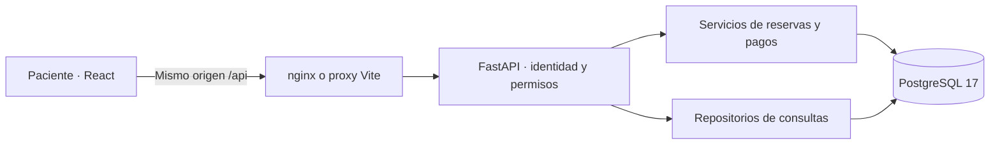

# Arquitectura y contratos

## Recorrido de una operación

El backend no confía en roles, importes, cobertura, disponibilidad ni confirmaciones calculadas por el cliente. Los importes salen del plan y se congelan en la retención. La confirmación comprueba que el plan y copago no hayan cambiado. Las fechas se almacenan con zona horaria y se presentan en Bogotá; los importes son enteros en COP.

## Estados

| Entidad | Estados / comportamiento |
| --- | --- |
| Rol de usuario | `PATIENT`, `ADMIN`, `DOCTOR`; registro público exclusivamente `PATIENT` |
| Sesión | Cookie opaca; hash del token y expiración persistidos en `sessions`; revocada en logout |
| Suscripción | `ACTIVE`, `INACTIVE`; API deriva `EXPIRED` cuando venció |
| Pago | `APPROVED`, `REJECTED`, `PENDING`, `IN_RECONCILIATION`; dos últimos conciliables a un resultado definitivo |
| Retención | `ACTIVE`, `CONFIRMED`, `RELEASED`; `ACTIVE` vencida deja de bloquear por `expires_at` |
| Cita | `CONFIRMED`, `CANCELLED`, `ATTENDED`; la atención es futura, el paciente no puede marcarla |

Un pago rechazado permite una operación nueva con otra clave; un reenvío con la misma clave retorna la original. Un pendiente impide otra operación para el mismo plan o retención. Un copago aprobado impide otro cobro para esa retención. Las repeticiones de confirmación retornan la cita original. Las repeticiones de cancelación se rechazan por versión o estado. El registro no se elimina.

## Bloqueos y defensa en la base

1. Transacción SQLAlchemy por solicitud.
2. Bloqueo `FOR UPDATE` del paciente para serializar planes, pagos y reservas propias.
3. Bloqueo `FOR UPDATE` del médico antes de validar y escribir retenciones, confirmación o cancelación.
4. Consultas de solapamiento por intervalo `[inicio, fin)` para médico y paciente, bloqueos administrativos, retenciones vigentes y citas confirmadas.
5. Al confirmar se verifica de nuevo la jornada original y el estado habilitado del médico.
6. Exclusiones GiST de PostgreSQL impiden solapamiento de citas confirmadas por médico y por paciente aun ante escrituras fuera del servicio. Unicidad por retención y por pago asociado evita duplicaciones.
7. La transacción incluye historial, notificación y auditoría; cualquier error hace rollback.
8. Dependencias FastAPI con `scope='function'` hacen commit antes de enviar éxito al cliente.

Las futuras operaciones administrativas sobre agenda y bloqueos deben adquirir el mismo bloqueo del médico; los módulos administrativos no están expuestos aquí. Fuentes técnicas: [bloqueos de PostgreSQL](https://www.postgresql.org/docs/17/explicit-locking.html) y [ciclo de dependencias FastAPI](https://fastapi.tiangolo.com/tutorial/dependencies/dependencies-with-yield/).

## API disponible

Contrato interactivo: `/docs`. JSON completo: `/openapi.json`. Las rutas protegidas exigen cookie de una sesión de paciente; el propietario se obtiene de esa sesión.

| Método | Ruta | Función |
| --- | --- | --- |
| GET | `/api/health` | Conectividad real de PostgreSQL |
| GET | `/api/config` | Modo demo y políticas públicas |
| POST | `/api/auth/register` | Registrar y autenticar paciente |
| POST | `/api/auth/login` | Iniciar sesión |
| POST | `/api/auth/logout` | Revocar sesión y borrar cookie |
| GET / PATCH | `/api/auth/me` | Perfil propio / actualizar nombre y teléfono |
| GET | `/api/dashboard` | Indicadores y próxima cita |
| GET | `/api/plans` | Catálogo y coberturas |
| GET | `/api/my-plan` | Plan y vigencia propios |
| GET | `/api/specialties` | Especialidades persistidas |
| GET | `/api/doctors?search=&specialty_id=` | Directorio con filtros |
| GET | `/api/doctors/{id}` | Perfil médico |
| GET | `/api/doctors/{id}/availability?day=YYYY-MM-DD` | Jornadas futuras, bloqueos y ocupación |
| POST | `/api/holds` | Retención; cuerpo `availability_id` |
| GET | `/api/holds/{id}` | Retención propia |
| POST | `/api/holds/{id}/release` | Abandonar retención propia |
| POST | `/api/holds/{id}/confirm` | Confirmación transaccional e idempotente |
| GET | `/api/payments` | Últimas 100 operaciones propias |
| POST | `/api/payments` | Simulación solo en demo: kind, target_id, status, idempotency_key |
| POST | `/api/payments/{id}/reconcile` | Resolver pendiente propio; solo demo |
| GET | `/api/appointments` | Citas propias de todos los estados |
| GET | `/api/appointments/{id}` | Comprobante e historial propios |
| POST | `/api/appointments/{id}/cancel` | version, reason y confirmed=true |
| GET | `/api/notifications` | Últimas 100 notificaciones propias |
| POST | `/api/notifications/{id}/read` | Marcar notificación propia |

Los endpoints públicos son health, config, planes, especialidades, registro, login y logout. Las respuestas no incluyen hashes de contraseñas ni tokens de sesión. Los pagos no aceptan un importe suministrado por el cliente. `extra='forbid'` rechaza campos no declarados en solicitudes Pydantic.

## Errores del dominio

HTTP 401: sesión ausente/vencida o credenciales inválidas. 403: rol/origen no autorizado o demo deshabilitada. 404: recurso inexistente o ajeno. 409: plan inactivo/vencido/sin cobertura, horario bloqueado/ocupado, retención vencida, pago pendiente, cambio de estado o versión, política de cancelación. 422: formulario inválido o falta de confirmación expresa. 503: error de base de datos con rollback. Los mensajes de negocio están en español.

## Alcance de seguridad

Las cookies se configuran como describe [FastAPI](https://fastapi.tiangolo.com/advanced/response-cookies/), usando sesión opaca persistida y sin acceso desde JavaScript. Se usa Argon2id para contraseñas, rechazo de orígenes cruzados, SQL parametrizado y un origen HTTP local. Se requiere endurecimiento adicional antes de exponer el sistema públicamente. Los esquemas de entrada, transacciones y autorización ya funcionan en el entorno local; no hay datos clínicos reales.
