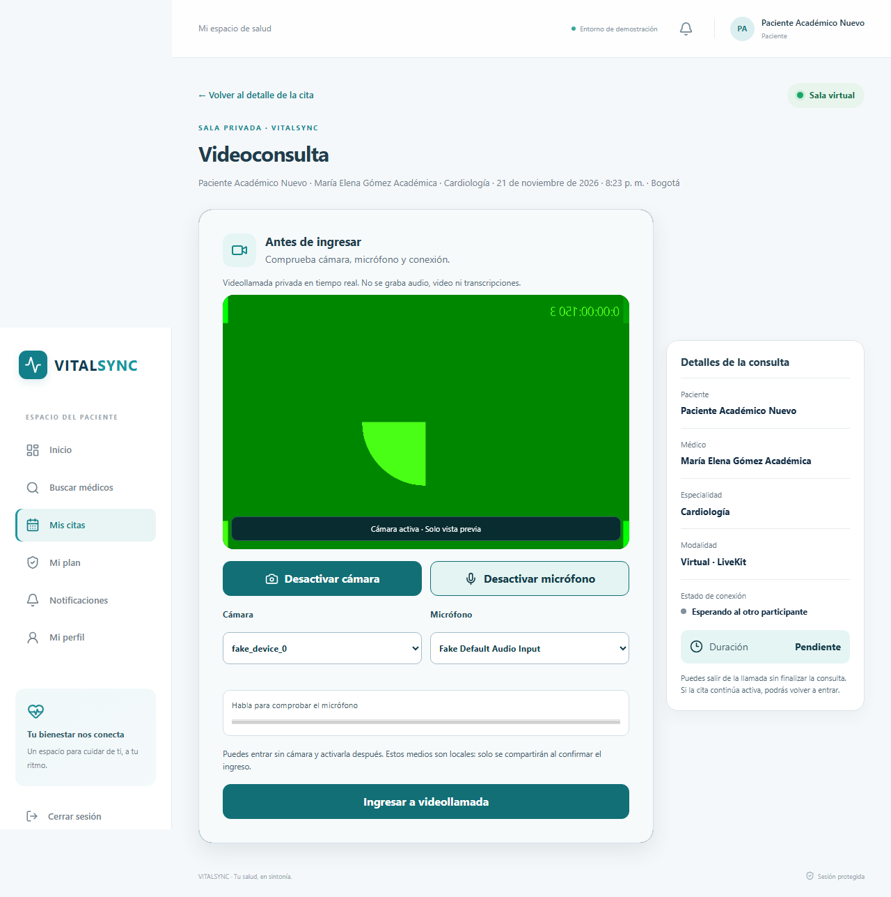
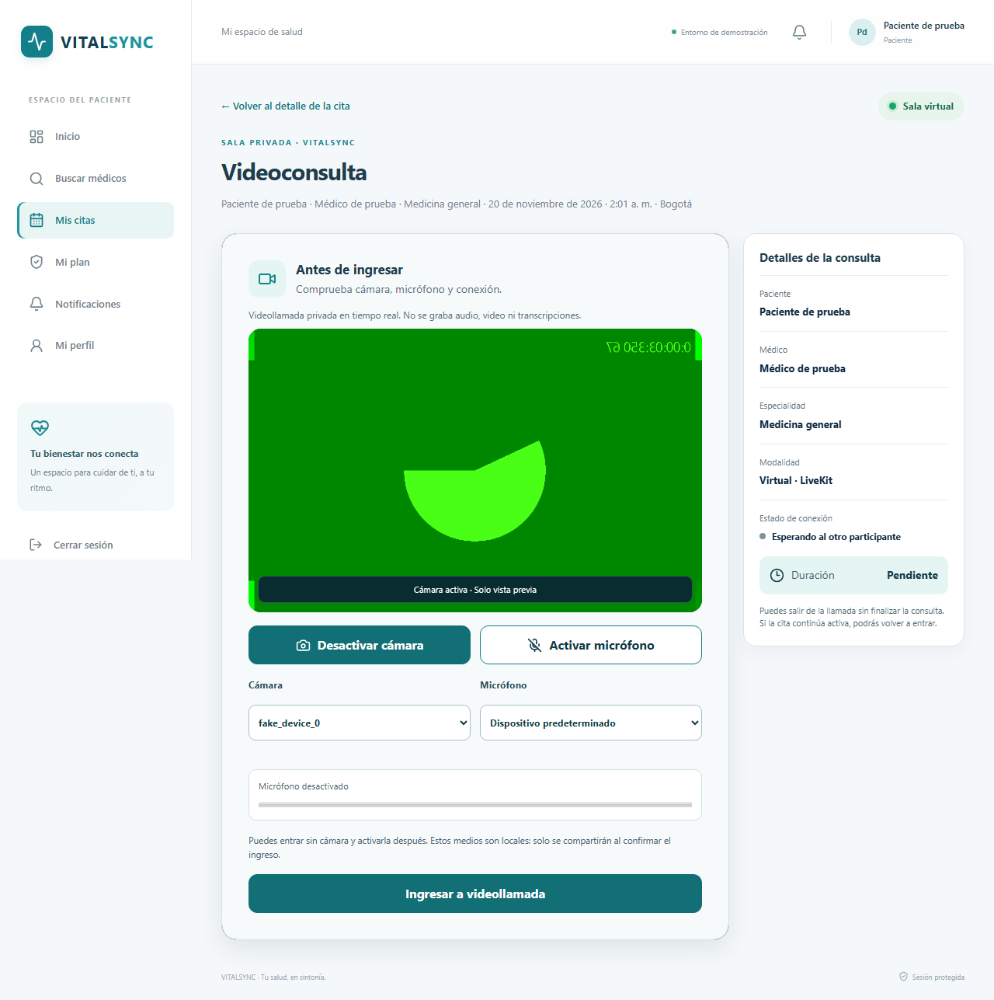
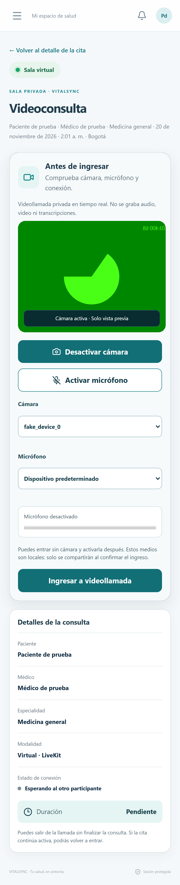
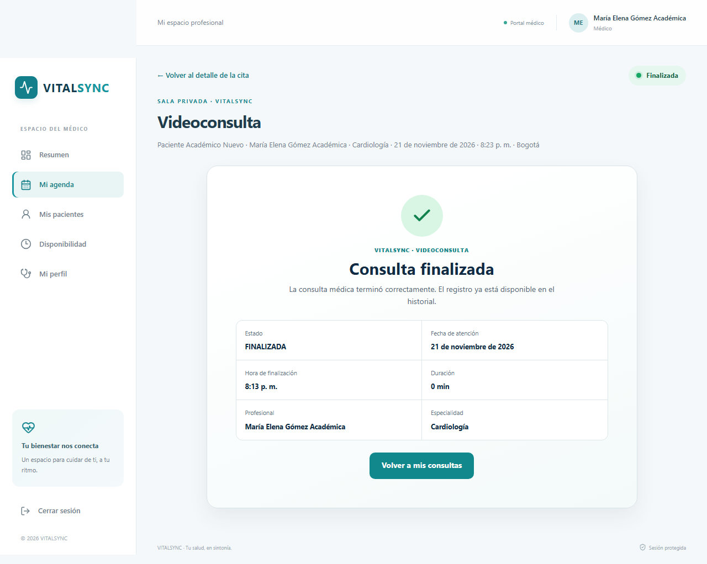

# Videollamadas para citas virtuales · v1.1.0

## Alcance

La rama `feature/video-calls-v1.1.0` agrega LiveKit autohospedado como proveedor opcional para las citas virtuales que ya registra VITALSYNC, junto con una ruta de consulta académica inmediata, exclusiva de `DEMO_MODE`. La versión estable `v1.0.0` y su etiqueta no se modifican.

La videollamada solo se habilita si el entorno tiene LiveKit configurado. Si LiveKit está apagado, continúan disponibles las pantallas demostrativas existentes. Pagos, citas presenciales e historias clínicas permanecen fuera del flujo audiovisual. Las pruebas inmediatas no usan los horarios del calendario, ni consumen planes, cobertura o copagos, ni modifican pagos o suscripciones.

## Arquitectura

- React carga `DevicePreview`, `LiveKitRoom`, los hooks oficiales de tracks/participantes y componentes LiveKit de video/audio bajo demanda desde los portales de paciente y médico. `DevicePreview` usa `createLocalVideoTrack`, `createLocalAudioTrack` y `createAudioAnalyser` del SDK ya instalado, sin conectarse a ninguna sala. La sala VitalSync renderiza el video remoto como escenario principal y el propio como vista flotante, con controles institucionales adaptables.
- FastAPI emite tokens cortos después de verificar sesión, rol, cita virtual, titularidad, asignación y ventana horaria.
- PostgreSQL conserva el nombre estable de la sala por cita, estado de conexión, auditoría e historial de eventos administrativos. Nunca almacena audio, video ni transcripciones.
- El servidor LiveKit se incorpora al Compose existente `vitalsync` bajo el perfil `video`; el volumen de PostgreSQL no cambia.
- Los webhooks firmados por LiveKit registran entradas y desconexiones. `event_id` único hace idempotente el registro de entregas repetidas.
- `POST /api/demo/livekit-sessions` crea una cita marcada `is_demo_test` vinculada al paciente y al médico autorizado. Una transacción con bloqueo por médico hace idempotentes los clics repetidos y evita dos sesiones simultáneas incompatibles. Un índice parcial PostgreSQL protege además al médico frente a carreras concurrentes.
- Solo se listan médicos vinculados a una cuenta activa y marcada como profesional demo; el paciente también debe tener registro explícito en `demo_patients`. El navegador no puede activar esta política enviando un parámetro.
- Las citas de prueba no tienen retención, plan, pago ni copago. La migración `20261122_demo_instant_calls` permite esas columnas nulas solo para citas marcadas como demo y virtuales; las citas ordinarias siguen exigiendo sus relaciones de cobertura y retención.

La fase de preparación es independiente de `LiveKitRoom`, proveedor React de la sesión ([LiveKitRoom](https://docs.livekit.io/reference/components/react/component/livekitroom/)). La aplicación solicita el token y conecta/publica únicamente cuando el participante confirma el ingreso.

## Preparación local en Windows

Desde PowerShell, en la carpeta del repositorio:

```powershell
if (-not (Test-Path .env)) { Copy-Item .env.example .env }
.\infrastructure\Configure-LiveKit.ps1
docker compose --profile video up -d --build
docker compose ps
```

El script genera una clave y un secreto aleatorios para el entorno local, conserva las demás variables existentes y no muestra los valores. `.env` permanece ignorado por Git. El perfil `video` es requerido para iniciar LiveKit. El volumen de PostgreSQL se declara externo como `vitalsync_vitalsync_data`; no ejecutar `down -v`.

Accesos de la aplicación: `http://localhost:5188/login`, `http://localhost:5188/portal`, `http://localhost:5188/doctor` y `http://localhost:8088/docs`.

## Variables

| Variable | Uso |
| --- | --- |
| `LIVEKIT_ENABLED` | Habilita las rutas reales en el backend. El script local la activa. |
| `LIVEKIT_API_KEY` / `LIVEKIT_API_SECRET` | Firma de tokens, API y webhooks; solo backend y LiveKit. No se compilan dentro de React. |
| `LIVEKIT_API_URL` | URL interna del servidor para las operaciones servidor a servidor. |
| `LIVEKIT_PUBLIC_URL` | URL WebSocket que el backend entrega al participante autorizado. En local es `ws://localhost:7880`. |
| `LIVEKIT_TOKEN_TTL_SECONDS` | Duración solicitada del token, limitada a 60–900 segundos (local: 600). |

La configuración local usa credenciales generadas y puertos ligados a loopback. Para cualquier ambiente público se requieren credenciales nuevas, TLS y valores separados; no se debe copiar `.env` local ni sus claves.

## Acceso y privacidad

- Paciente: solo puede obtener token para sus propias citas virtuales.
- Médico: solo para una cita virtual asignada a su perfil profesional vinculado.
- Administrador: consulta metadatos de conexión desde el portal, sin acceso a salas ni medios.
- Presencial, cancelada, finalizada, fuera de horario, usuario anónimo o participante externo: sin token.
- Los tokens permiten entrar únicamente a la sala persistida de la cita y publicar cámara/micrófono. No permiten crear/listar salas, administrar, grabar ni publicar datos de sala. La identidad técnica es `user:<id>`; el nombre visible es el rol genérico.
- No hay grabación, transcripción, exportación audiovisual ni historia clínica dentro de la sala. La auditoría guarda tipo de evento, rol, usuario y cita, nunca contenido multimedia.

Rutas de acceso: `POST /api/appointments/{id}/livekit-token` para el titular paciente y `POST /api/doctor/appointments/{id}/livekit-token` para el médico asignado. La finalización formal corresponde a `POST /api/doctor/appointments/{id}/livekit-finalize`.

En **Mis citas** aparece **Prueba una videollamada ahora** únicamente para un paciente identificado por el backend como cuenta demo cuando `DEMO_MODE` y LiveKit están activos. El paciente elige uno de los cinco médicos académicos, confirma y entra a una sala privada de LiveKit que también aparece de inmediato en la agenda del profesional. El detalle lleva la etiqueta **Consulta académica de prueba**. Se conservan las verificaciones de rol, titularidad y asignación. El bypass de horario se permite solo para una cita marcada demo cuando el backend mantiene `DEMO_MODE=true`; las citas normales siguen respetando su ventana.

## Estados y ciclo

La cita virtual conserva su ciclo de negocio actual. El estado técnico LiveKit se muestra aparte como `WAITING`, `CONNECTED`, `RECONNECTING` o `DISCONNECTED`. Cada sala tiene un nombre aleatorio estable creado al confirmar la cita; recargar o solicitar otro token no genera una sala nueva.

Cuando ambos participantes se conectan, la cita pasa a `IN_PROGRESS` y se registran el historial y auditoría. Una pérdida de conexión actualiza solo el estado técnico y permite reconectar; cerrar la pestaña no finaliza la consulta. **Salir de la llamada** detiene cámara/micrófono locales, desconecta al participante y devuelve al portal; no marca finalización, y el participante restante ve el aviso de espera/reconexión. **Finalizar consulta** solo aparece para el médico asignado si la cita está `IN_PROGRESS` y la teleconsulta `EN_ATENCION`. El médico confirma en un diálogo; la operación actualiza PostgreSQL, notifica al paciente, invalida nuevos tokens y solicita el cierre de LiveKit. Un error temporal al cerrar el proveedor se reintenta tres veces; una repetición idempotente del endpoint vuelve a intentar el cierre sin duplicar auditoría o transiciones.

Ambos participantes reciben la pantalla **Consulta finalizada** consultando el registro persistido: estado, fecha, hora y duración se basan en `started_at` / `finalized_at` de la sesión. Los historiales del paciente y médico muestran el estado `ATTENDED` (presentado como Finalizada); el administrador ve `status_label=FINALIZADA` y los metadatos de inicio/finalización/duración, sin contenido clínico. Los webhooks LiveKit tardíos se registran por `event_id`, pero ya no pueden alterar el estado terminal ni agregar transiciones posteriores.

La interfaz de administración muestra si el proveedor está configurado y el estado de conexión; no expone nombre de sala, token ni medios.

## Dispositivos y errores

`DevicePreview` inicia cámara y micrófono por separado tras pulsar **Activar cámara** / **Activar micrófono**. Las opciones elegidas se transmiten como `audio`/`video` y defaults de captura a `LiveKitRoom`. Se permite entrar sin cámara; no se reutilizan silenciosamente los flags antiguos de `lk-user-choices`. Un error de micrófono no elimina una vista previa de cámara válida.

La cámara local se adjunta a un video `muted`, `autoPlay`, `playsInline`. Si la reproducción requiere una interacción adicional, aparece **Mostrar vista previa**. El medidor de micrófono analiza localmente el volumen, sin reproducirlo ni grabarlo. `enumerateDevices` y `devicechange` actualizan las listas. Al cambiar de dispositivo se liberan las pistas anteriores; las adquisiciones que terminan después de desmontar se detienen. Al confirmar ingreso se detienen los medios de preparación antes de crear los medios de sala, evitando ocupar dos veces la webcam. La limpieza también desacopla el video, cierra el analizador y retira listeners.

Permiso denegado, dispositivo inexistente/ocupado, restricciones incompatibles, desconexión del dispositivo y contexto inseguro tienen mensajes distintos en español y opción de reintentar. Una selección incompatible intenta recuperar el dispositivo predeterminado. Para contexto no seguro se indica HTTPS o localhost. El ingreso solo se bloquea durante adquisición/solicitud de acceso o cuando el navegador carece de un contexto seguro/API multimedia; un error de cámara no bloquea el audio disponible.

En la sala, los controles cambian cámara y micrófono; el menú oficial LiveKit permite seleccionar entrada de audio, cámara y salida de audio. Una cámara remota apagada muestra su estado en vez de un último fotograma congelado. Compartir pantalla permanece deshabilitado porque los tokens del backend solo permiten publicar cámara y micrófono. Se puede volver a preparación y solicitar un token nuevo mientras la cita siga activa y dentro de su ventana.

Los tokens duran como máximo 15 minutos. Si expiran antes del ingreso, se solicita otro mediante la misma comprobación de permisos. Una consulta finalizada o cancelada nunca vuelve a emitirlos.

## Docker y puertos

El servicio corre dentro de la red del proyecto Compose `vitalsync` y se inicia con el perfil `video`. En el equipo local:

- `7880/TCP`: señalización y WebSocket.
- `7881/TCP`: transporte WebRTC/TCP de respaldo.
- `50000–50100/UDP`: medios WebRTC/ICE.

Los puertos publicados en este Compose local quedan asociados a `127.0.0.1`. LiveKit documenta además los puertos ICE/TURN y requiere una dirección pública conocida para despliegues detrás de NAT ([puertos y firewall](https://docs.livekit.io/transport/self-hosting/ports-firewall/), [despliegue self-hosted](https://docs.livekit.io/transport/self-hosting/deployment/)).

## Pruebas

### Corrección de vista previa y contraste · 20 de noviembre de 2026

El diagnóstico se reprodujo contra la implementación anterior, con respuestas API de fixture y medios sintéticos (sin escribir datos principales): en 3,2 segundos, `getUserMedia` aumentó de 3 a 12 solicitudes. `LiveKitConsultation` actualiza el reloj cada segundo y pasaba a `PreJoin` un `onError` inline. En la versión instalada, `usePreviewTracks` incluye ese callback en las dependencias del efecto; cada nueva referencia limpiaba las pistas y reiniciaba la captura. Esto interrumpía la vista previa y podía impedir que una webcam física terminara de iniciar. La prueba física de ese comportamiento queda pendiente.

Se comprobaron además tres problemas de integración: las reglas `[data-lk-theme="default"]` no alcanzaban al preingreso (ese atributo solo estaba en la sala), el prefab restauraba silenciosamente flags/dispositivos persistidos, y `LiveKitRoom` recibía únicamente booleanos, descartando los identificadores elegidos. La validación anterior del botón dependía del nombre local, mientras que el estado `busy` no deshabilitaba el botón del prefab. La identidad de sala real sigue siendo validada por el backend.

La corrección usa controles propios de preingreso y las APIs locales del SDK existente. Los callbacks/objetos que controlan la conexión son estables; los errores de captura no reinician medios por render. No se agregaron dependencias, endpoints, migraciones ni cambios de autenticación/roles/Google. Los errores no muestran mensajes internos del navegador ni tokens. La interfaz tiene botones de al menos 48 px, foco visible, texto/iconos explícitos y estados disabled sin opacidad excesiva; se conserva Detalles de la consulta.

Validación de esta corrección:

- **64 pruebas frontend aprobadas**: captura independiente, errores y reintento, origen inseguro, fallback de restricciones, cambio de cámara/micrófono, audio solo, dispositivo desconectado, inventario fallido, adquisiciones tardías, limpieza y traslado de preferencias a la sala.
- **12 pruebas E2E de preingreso aprobadas**, en escritorio y móvil: frames de video sintético estables a través de tres renders del reloj, ausencia de reinicios, errores inyectados `NotAllowedError` / `NotFoundError` / `NotReadableError` con recuperación, cambio de dispositivo y limpieza al navegar, foco/contraste de texto mínimo 4,5:1 y ausencia de token antes de ingresar. La denegación/ocupación se simula en `getUserMedia`; no se cambian permisos reales del sistema.
- **50 pruebas backend pertinentes aprobadas**: `test_livekit_consultations.py`, `test_doctor_portal.py`, `test_demo_livekit.py`, `test_google_auth.py`, en una base aislada `vitalsync_test_audit_preview_*`.
- **E2E Google controlado + LiveKit aprobado**, en Docker y otra base aislada: prepara medios en ambos roles, ingresa paciente solo con audio, activa cámara dentro, silencia/restaura micrófono, apaga/restaura cámara remota, comprueba frames y pistas de audio recibidas, sale/reingresa, reconecta y finaliza con historial y proyección administrativa. No equivale a una prueba audible ni con hardware físico.
- **Compilación React aprobada**; permanece el aviso existente de chunks mayores de 500 kB.
- **Docker actualizado y comprobado**: frontend, backend y PostgreSQL saludables; LiveKit en ejecución. Las 12 pruebas de preingreso se repitieron contra el frontend compilado servido por Docker y también aprobaron. Los hashes agregados de usuarios, pacientes, citas y pagos coinciden antes/después del despliegue (61 usuarios, 55 pacientes, 67 citas y 148 pagos en ese momento). Se conserva `vitalsync_vitalsync_data` y la cabeza Alembic existente; no hubo cambios en la base principal.

Para repetir la prueba del preingreso contra Docker (las API son fixtures del navegador y no escriben datos principales):

```powershell
cd frontend
npm run test:e2e -- prejoin.spec.ts --output test-results-prejoin
```

La prueba multimedia con dos participantes se repite con `infrastructure/test-livekit.ps1 -GoogleProviderFixture`. Las dos ejecuciones Playwright se realizan secuencialmente.

### Comprobación manual con webcam física en Chrome

1. Recarga `http://localhost:5188/login` con Ctrl+F5 e inicia sesión como paciente. En Mis citas abre una cita virtual autorizada o una consulta académica de prueba.
2. En Antes de ingresar pulsa **Activar cámara** y permite su uso en el diálogo de Chrome. Debe aparecer tu imagen y el estado Cámara activa, sin desconexiones periódicas. Activa el micrófono, habla y comprueba el medidor.
3. Cambia cámara/micrófono en las listas. Comprueba que la imagen cambia y que apagar cámara conserva la posibilidad de entrar con audio. Si Chrome denegó el permiso, abre los controles del sitio junto a la dirección, cambia cámara/micrófono a Permitir y pulsa Reintentar; si el navegador lo exige, recarga la página.
4. En otro perfil de Chrome, ventana privada o equipo inicia como médico y abre la misma cita desde Mi agenda. Repite la preparación y entra. Si una webcam no admite acceso simultáneo desde dos sesiones, usa otro equipo/cámara o deja una sesión solo con audio; el mensaje de dispositivo ocupado no implica un fallo de permisos o backend.
5. Comprueba imagen/audio de ambos lados, controles, selección de dispositivos en sala, Salir y reingreso. Finalizar consulta solo lo confirma el médico y deja la cita en historial.

Pendiente manual: permisos reales de Chrome/Windows, webcam(s) físicas, cambio entre dos cámaras físicas, calidad audible y redes distintas. Esta entrega valida únicamente medios sintéticos y errores controlados. Ninguna captura contiene imagen de cámara física ni se graba audio/video.

Las pruebas de la ruta académica cubren los cinco médicos, citas sin plan ni pago, repetición idempotente, bloqueo a pacientes normales y rechazo de un médico ocupado. Las pruebas de migración verifican una única cabeza Alembic. El E2E de medios inicia la prueba desde **Mis citas**, confirma que el médico ve la etiqueta académica en su agenda y conecta ambas cuentas usando medios sintéticos por defecto; después verifica finalización formal e historial.

Backend: `.\infrastructure\Test-Backend.ps1` crea una base de pruebas aislada con prefijo `vitalsync_test_audit_`; las pruebas no usan ni truncan la base `vitalsync`.

Para una comprobación audiovisual local entre dos contextos Chromium con entradas sintéticas de cámara y micrófono:

```powershell
.\infrastructure\test-livekit.ps1
```

La variante `.\infrastructure\test-livekit.ps1 -UsePhysicalDevices` usa los dispositivos físicos conectados. Apaga screenshots y trazas para no guardar imágenes o contenido de la cámara. Ambos modos levantan una base aislada y transmiten medios solo a LiveKit local; no se graban.

El script crea otra base temporal aislada, emite credenciales de fixture a una carpeta local protegida, inicia el servicio LiveKit de prueba en el mismo proyecto y ejecuta el E2E de medios. El modo sintético verifica video y pistas de audio activas en ambos navegadores, desconexión voluntaria sin cambiar `IN_PROGRESS`, reingreso, reconexión y finalización confirmada por paciente, médico y administrador. También guarda capturas de la sala y pantalla final en escritorio y móvil. La prueba física usa los medios localmente y no guarda capturas, trazas ni grabaciones. No mide calidad audible ni equivale a una llamada entre redes distintas.

## Capturas

El E2E local completó la preparación, conexión de dos participantes, publicación y recepción de video/audio, reconexión tras recargar el portal médico y finalización. Las capturas siguientes se generaron con medios sintéticos reproducibles. En la corrección de preingreso del 20 de noviembre no se probaron dispositivos físicos.











## Diferentes redes y limitaciones

Esta configuración no habilita conexiones desde Internet ni desde otra red. Para ello hacen falta un dominio resoluble, HTTPS para la aplicación, WSS para LiveKit, certificados públicos válidos, DNS, dirección pública anunciada por el servidor, configuración NAT/firewall y puertos WebRTC accesibles. Redes corporativas pueden requerir TURN/TLS o TURN/UDP. LiveKit advierte que el despliegue WebRTC debe exponer sus puertos ICE y anunciar correctamente la IP ([requisitos de firewall](https://docs.livekit.io/transport/self-hosting/ports-firewall/)).

No se contrataron servicios, publicaron puertos, crearon DNS ni desplegaron TURN. Esa validación queda pendiente de infraestructura y autorización. El producto sigue siendo académico y no reemplaza atención clínica real.
## Sala de simulación académica

En modo demostración, el menú **Probar videollamada** abre una sala individual o privada sin agenda ni cobros. Los médicos ficticios y los pacientes de demostración pueden utilizarla. Para una cuenta paciente ficticia recién registrada, un administrador con permiso de cuentas puede habilitarla en **Pacientes → Autorizar simulación**. El permiso queda auditado y es independiente de la atención clínica.

La sala privada admite un anfitrión y un invitado. El código se comparte por un canal privado, se reserva al primer invitado autorizado y dura hasta 30 minutos. Es posible volver a ingresar desde la lista de salas activas. Los intentos de invitación se limitan por cuenta. El anfitrión puede terminar la simulación y revocar nuevos ingresos.

Compose desactiva la creación automática de salas en LiveKit. FastAPI verifica la autorización y el estado persistido antes de crear una sala. Después del cierre, un token anterior no puede volver a crearla. El cliente cierra la simulación cuando vence su plazo y la API deja de emitir tokens. El límite de participantes se aplica también dentro de LiveKit.

La vista previa permite entrar sin cámara ni micrófono. Los controles de sala permiten cambiar dispositivos, consultar participantes, compartir pantalla según el navegador y alternar pantalla completa. No se graban audio, video ni transcripciones. PostgreSQL guarda las salas en tablas separadas de citas y pagos. Los webhooks de simulación no actualizan registros clínicos.

Para un entorno nuevo, conserva la configuración documentada de LiveKit y arranca con `docker compose --profile video up -d --build --wait`. En una instalación existente que deba conservar cero pacientes, configura `VITALSYNC_STARTUP_SEED=false` en el archivo local `.env`. Mantén el modo demo habilitado para usar las salas académicas.
