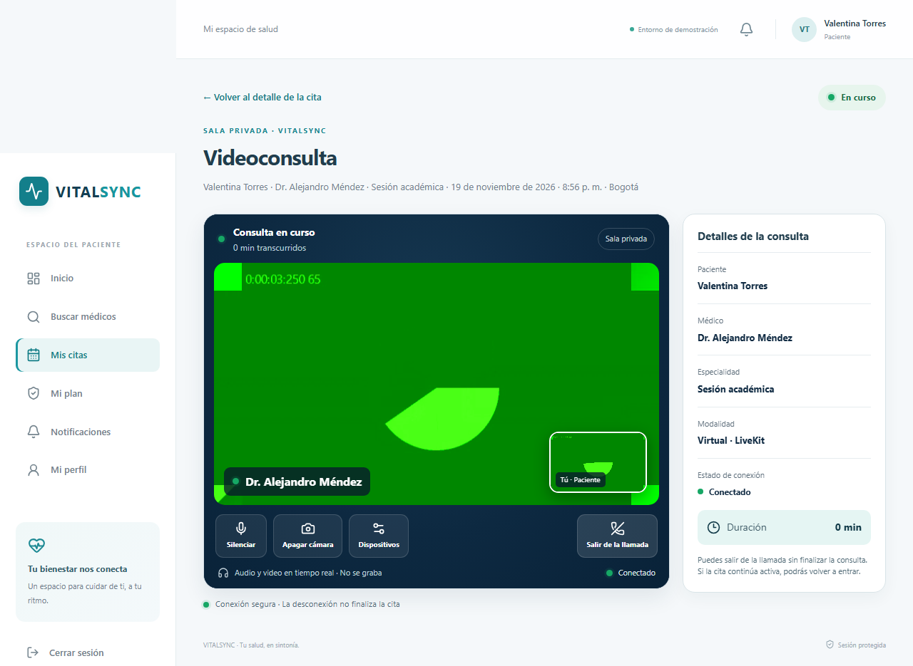
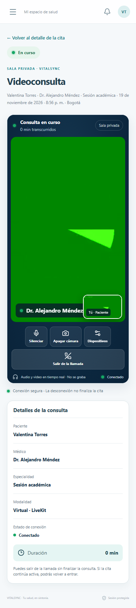
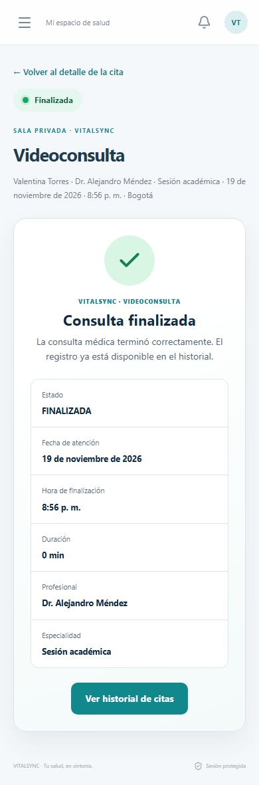

# Videollamadas para citas virtuales · v1.1.0

## Alcance

La rama `feature/video-calls-v1.1.0` agrega LiveKit autohospedado como proveedor opcional para las citas virtuales que ya registra VITALSYNC, junto con una ruta de consulta académica inmediata, exclusiva de `DEMO_MODE`. La versión estable `v1.0.0` y su etiqueta no se modifican.

La videollamada solo se habilita si el entorno tiene LiveKit configurado. Si LiveKit está apagado, continúan disponibles las pantallas demostrativas existentes. Pagos, citas presenciales e historias clínicas permanecen fuera del flujo audiovisual. Las pruebas inmediatas no usan los horarios del calendario, ni consumen planes, cobertura o copagos, ni modifican pagos o suscripciones.

## Arquitectura

- React carga `PreJoin`, `LiveKitRoom`, los hooks oficiales de tracks/participantes y componentes LiveKit de video/audio bajo demanda desde los portales de paciente y médico. La sala VitalSync renderiza el video remoto como escenario principal y el propio como vista flotante, con controles institucionales adaptables.
- FastAPI emite tokens cortos después de verificar sesión, rol, cita virtual, titularidad, asignación y ventana horaria.
- PostgreSQL conserva el nombre estable de la sala por cita, estado de conexión, auditoría e historial de eventos administrativos. Nunca almacena audio, video ni transcripciones.
- El servidor LiveKit se incorpora al Compose existente `vitalsync` bajo el perfil `video`; el volumen de PostgreSQL no cambia.
- Los webhooks firmados por LiveKit registran entradas y desconexiones. `event_id` único hace idempotente el registro de entregas repetidas.
- `POST /api/demo/livekit-sessions` crea una cita marcada `is_demo_test` vinculada al paciente y al médico autorizado. Una transacción con bloqueo por médico hace idempotentes los clics repetidos y evita dos sesiones simultáneas incompatibles. Un índice parcial PostgreSQL protege además al médico frente a carreras concurrentes.
- Solo se listan médicos vinculados a una cuenta activa y marcada como profesional demo; el paciente también debe tener registro explícito en `demo_patients`. El navegador no puede activar esta política enviando un parámetro.
- Las citas de prueba no tienen retención, plan, pago ni copago. La migración `20261122_demo_instant_calls` permite esas columnas nulas solo para citas marcadas como demo y virtuales; las citas ordinarias siguen exigiendo sus relaciones de cobertura y retención.

LiveKit documenta `PreJoin` para previsualizar y seleccionar cámara y micrófono antes de conectar, y `LiveKitRoom` como proveedor React de la sesión ([PreJoin](https://docs.livekit.io/reference/components/react/component/prejoin/), [LiveKitRoom](https://docs.livekit.io/reference/components/react/component/livekitroom/)).

## Preparación local en Windows

Desde PowerShell, en la carpeta del repositorio:

```powershell
if (-not (Test-Path .env)) { Copy-Item .env.example .env }
.\infrastructure\Configure-LiveKit.ps1
docker compose --profile video up -d --build
docker compose ps
```

El script genera una clave y un secreto aleatorios para el entorno local, conserva las demás variables existentes y no muestra los valores. `.env` permanece ignorado por Git. El perfil `video` es requerido para iniciar LiveKit. El volumen de PostgreSQL se declara externo como `vitalsync_vitalsync_data`; no ejecutar `down -v`.

Accesos de la aplicación: `http://localhost:5188/login`, `http://localhost:5188/portal`, `http://localhost:5188/doctor` y `http://localhost:8088/docs`.

## Variables

| Variable | Uso |
| --- | --- |
| `LIVEKIT_ENABLED` | Habilita las rutas reales en el backend. El script local la activa. |
| `LIVEKIT_API_KEY` / `LIVEKIT_API_SECRET` | Firma de tokens, API y webhooks; solo backend y LiveKit. No se compilan dentro de React. |
| `LIVEKIT_API_URL` | URL interna del servidor para las operaciones servidor a servidor. |
| `LIVEKIT_PUBLIC_URL` | URL WebSocket que el backend entrega al participante autorizado. En local es `ws://localhost:7880`. |
| `LIVEKIT_TOKEN_TTL_SECONDS` | Duración solicitada del token, limitada a 60–900 segundos (local: 600). |

La configuración local usa credenciales generadas y puertos ligados a loopback. Para cualquier ambiente público se requieren credenciales nuevas, TLS y valores separados; no se debe copiar `.env` local ni sus claves.

## Acceso y privacidad

- Paciente: solo puede obtener token para sus propias citas virtuales.
- Médico: solo para una cita virtual asignada a su perfil profesional vinculado.
- Administrador: consulta metadatos de conexión desde el portal, sin acceso a salas ni medios.
- Presencial, cancelada, finalizada, fuera de horario, usuario anónimo o participante externo: sin token.
- Los tokens permiten entrar únicamente a la sala persistida de la cita y publicar cámara/micrófono. No permiten crear/listar salas, administrar, grabar ni publicar datos de sala. La identidad técnica es `user:<id>`; el nombre visible es el rol genérico.
- No hay grabación, transcripción, exportación audiovisual ni historia clínica dentro de la sala. La auditoría guarda tipo de evento, rol, usuario y cita, nunca contenido multimedia.

Rutas de acceso: `POST /api/appointments/{id}/livekit-token` para el titular paciente y `POST /api/doctor/appointments/{id}/livekit-token` para el médico asignado. La finalización formal corresponde a `POST /api/doctor/appointments/{id}/livekit-finalize`.

En **Mis citas** aparece **Prueba una videollamada ahora** únicamente para un paciente identificado por el backend como cuenta demo cuando `DEMO_MODE` y LiveKit están activos. El paciente elige uno de los cinco médicos académicos, confirma y entra a una sala privada de LiveKit que también aparece de inmediato en la agenda del profesional. El detalle lleva la etiqueta **Consulta académica de prueba**. Se conservan las verificaciones de rol, titularidad y asignación. El bypass de horario se permite solo para una cita marcada demo cuando el backend mantiene `DEMO_MODE=true`; las citas normales siguen respetando su ventana.

## Estados y ciclo

La cita virtual conserva su ciclo de negocio actual. El estado técnico LiveKit se muestra aparte como `WAITING`, `CONNECTED`, `RECONNECTING` o `DISCONNECTED`. Cada sala tiene un nombre aleatorio estable creado al confirmar la cita; recargar o solicitar otro token no genera una sala nueva.

Cuando ambos participantes se conectan, la cita pasa a `IN_PROGRESS` y se registran el historial y auditoría. Una pérdida de conexión actualiza solo el estado técnico y permite reconectar; cerrar la pestaña no finaliza la consulta. **Salir de la llamada** detiene cámara/micrófono locales, desconecta al participante y devuelve al portal; no marca finalización, y el participante restante ve el aviso de espera/reconexión. **Finalizar consulta** solo aparece para el médico asignado si la cita está `IN_PROGRESS` y la teleconsulta `EN_ATENCION`. El médico confirma en un diálogo; la operación actualiza PostgreSQL, notifica al paciente, invalida nuevos tokens y solicita el cierre de LiveKit. Un error temporal al cerrar el proveedor se reintenta tres veces; una repetición idempotente del endpoint vuelve a intentar el cierre sin duplicar auditoría o transiciones.

Ambos participantes reciben la pantalla **Consulta finalizada** consultando el registro persistido: estado, fecha, hora y duración se basan en `started_at` / `finalized_at` de la sesión. Los historiales del paciente y médico muestran el estado `ATTENDED` (presentado como Finalizada); el administrador ve `status_label=FINALIZADA` y los metadatos de inicio/finalización/duración, sin contenido clínico. Los webhooks LiveKit tardíos se registran por `event_id`, pero ya no pueden alterar el estado terminal ni agregar transiciones posteriores.

La interfaz de administración muestra si el proveedor está configurado y el estado de conexión; no expone nombre de sala, token ni medios.

## Dispositivos y errores

`PreJoin` ofrece vista previa y permisos de dispositivos. En la sala, los controles cambian cámara y micrófono; el menú oficial LiveKit permite seleccionar entrada de audio, cámara y salida de audio. Compartir pantalla permanece deshabilitado porque los tokens del backend solo permiten publicar cámara y micrófono. Permisos denegados, falta de dispositivos, servidor no disponible o red interrumpida se muestran con mensajes entendibles; se puede volver a preparación y solicitar un token nuevo mientras la cita siga activa y dentro de su ventana.

Los tokens duran como máximo 15 minutos. Si expiran antes del ingreso, se solicita otro mediante la misma comprobación de permisos. Una consulta finalizada o cancelada nunca vuelve a emitirlos.

## Docker y puertos

El servicio corre dentro de la red del proyecto Compose `vitalsync` y se inicia con el perfil `video`. En el equipo local:

- `7880/TCP`: señalización y WebSocket.
- `7881/TCP`: transporte WebRTC/TCP de respaldo.
- `50000–50100/UDP`: medios WebRTC/ICE.

Los puertos publicados en este Compose local quedan asociados a `127.0.0.1`. LiveKit documenta además los puertos ICE/TURN y requiere una dirección pública conocida para despliegues detrás de NAT ([puertos y firewall](https://docs.livekit.io/transport/self-hosting/ports-firewall/), [despliegue self-hosted](https://docs.livekit.io/transport/self-hosting/deployment/)).

## Pruebas

Las pruebas de la ruta académica cubren los cinco médicos, citas sin plan ni pago, repetición idempotente, bloqueo a pacientes normales y rechazo de un médico ocupado. Las pruebas de migración verifican una única cabeza Alembic. El E2E real de medios inicia la prueba desde **Mis citas**, confirma que el médico ve la etiqueta académica en su agenda y conecta ambas cuentas usando la cámara/micrófono físicos; después verifica finalización formal e historial.

Backend: `.\infrastructure\Test-Backend.ps1` crea una base de pruebas aislada con prefijo `vitalsync_test_audit_`; las pruebas no usan ni truncan la base `vitalsync`.

Para una comprobación audiovisual local entre dos contextos Chromium con entradas sintéticas de cámara y micrófono:

```powershell
.\infrastructure\test-livekit.ps1
```

La variante `.\infrastructure\test-livekit.ps1 -UsePhysicalDevices` usa los dispositivos físicos conectados. Apaga screenshots y trazas para no guardar imágenes o contenido de la cámara. Ambos modos levantan una base aislada y transmiten medios solo a LiveKit local; no se graban.

El script crea otra base temporal aislada, emite credenciales de fixture a una carpeta local protegida, inicia el servicio LiveKit de prueba en el mismo proyecto y ejecuta el E2E de medios. El modo sintético verifica video y pistas de audio activas en ambos navegadores, desconexión voluntaria sin cambiar `IN_PROGRESS`, reingreso, reconexión y finalización confirmada por paciente, médico y administrador. También guarda capturas de la sala y pantalla final en escritorio y móvil. La prueba física usa los medios localmente y no guarda capturas, trazas ni grabaciones. No mide calidad audible ni equivale a una llamada entre redes distintas.

## Capturas

El E2E local completó la preparación, conexión de dos participantes, publicación y recepción de video/audio, reconexión tras recargar el portal médico y finalización. Las capturas siguientes se generaron con medios sintéticos reproducibles; la prueba con dispositivos físicos pasó sin generar capturas.









## Diferentes redes y limitaciones

Esta configuración no habilita conexiones desde Internet ni desde otra red. Para ello hacen falta un dominio resoluble, HTTPS para la aplicación, WSS para LiveKit, certificados públicos válidos, DNS, dirección pública anunciada por el servidor, configuración NAT/firewall y puertos WebRTC accesibles. Redes corporativas pueden requerir TURN/TLS o TURN/UDP. LiveKit advierte que el despliegue WebRTC debe exponer sus puertos ICE y anunciar correctamente la IP ([requisitos de firewall](https://docs.livekit.io/transport/self-hosting/ports-firewall/)).

No se contrataron servicios, publicaron puertos, crearon DNS ni desplegaron TURN. Esa validación queda pendiente de infraestructura y autorización. El producto sigue siendo académico y no reemplaza atención clínica real.
